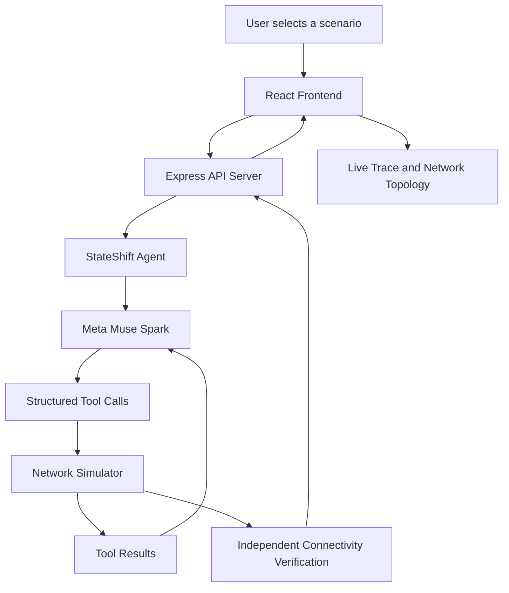
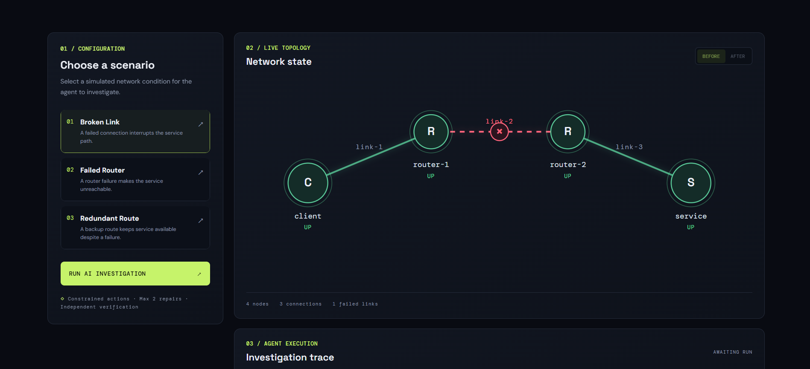
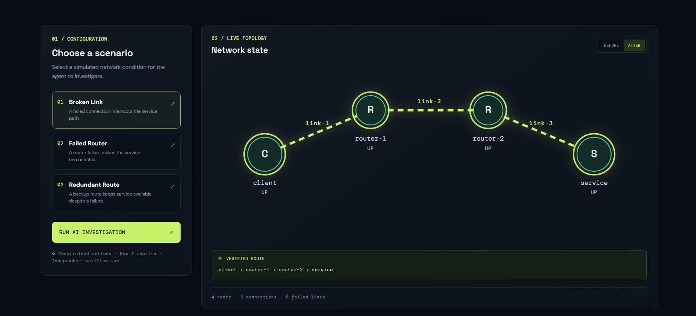
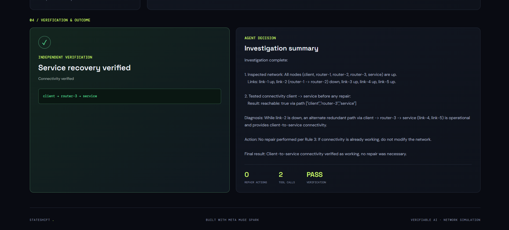

# StateShift

### An AI Agent That Investigates, Repairs, and Verifies Network Failures

StateShift is a visual AI-powered network troubleshooting system built around **Meta Muse Spark**. It investigates simulated infrastructure failures, diagnoses the underlying problem, executes constrained recovery actions, and independently verifies whether connectivity has been restored.

Instead of simply recommending a fix, StateShift lets an AI agent interact with a functioning network simulator through structured tools. Every investigation is observable through a live execution trace and an interactive network topology.

---

## The Problem

Infrastructure failures require more than identifying a component that appears unhealthy. An effective troubleshooting system must:

- Inspect the actual system state.
- Determine whether a service is genuinely unreachable.
- Identify the component responsible for the failure.
- Avoid unnecessary interventions.
- Execute a bounded recovery action.
- Independently verify that the service is operational again.

StateShift explores how an AI agent can perform this workflow while keeping the execution environment deterministic, observable, and constrained.

## How StateShift Works

The investigation follows a closed-loop workflow:

**Observe → Diagnose → Decide → Repair → Verify**

1. **Observe:** Muse Spark calls `inspect_network` to examine the simulated infrastructure.
2. **Diagnose:** The agent calls `test_connectivity` to determine whether the client can reach the service.
3. **Decide:** It reasons about the observed node and link states and determines whether intervention is necessary.
4. **Repair:** If a confirmed failure exists, it calls the appropriate recovery tool.
5. **Verify:** The simulator independently tests connectivity and determines the final outcome.

The frontend displays the investigation as it happens, including tool execution, network state transitions, and the verified route.

## Architecture



### Main Components

| Component | Responsibility |
|---|---|
| React frontend | Scenario selection, interactive topology, live investigation trace |
| Express server | API endpoints and streaming agent execution |
| StateShift agent | Model interaction, tool orchestration, execution constraints |
| Network simulator | Network state, connectivity testing, and recovery operations |
| Muse Spark | Diagnosis, decision-making, and structured tool selection |

## Meta Muse Spark Integration

StateShift uses Meta Muse Spark through its API-compatible integration.

- **Model:** `muse-spark-1.3`
- **API base URL:** `https://api.meta.ai/v1`
- **Integration:** OpenAI-compatible JavaScript SDK
- **Interaction:** Structured function/tool calling

The model can select from four tools:

| Tool | Purpose |
|---|---|
| `inspect_network` | Inspect all simulated network nodes and links |
| `test_connectivity` | Test reachability between two nodes |
| `repair_link` | Restore a failed network link |
| `restart_node` | Restart a failed network node |

Tool calls are executed by the application against the simulator. The model does not directly modify network state.

## Safety and Execution Constraints

StateShift uses application-enforced safeguards to constrain agent actions.

- **Inspect first:** The network must be inspected before recovery actions.
- **Verify before acting:** Connectivity is tested before deciding whether to repair.
- **No unnecessary repairs:** Recovery actions are denied when client-to-service connectivity already works.
- **Confirmed failures only:** A link or node must exist and be confirmed down before it can be repaired or restarted.
- **Bounded execution:** A maximum of two successful repair actions is allowed.
- **Independent verification:** The simulator, rather than the model's response, determines whether recovery succeeded.
- **Observable execution:** Tool calls and their results are recorded in the investigation trace.

The agent also operates with a maximum of six model turns per investigation.

## Demonstration Scenarios

StateShift includes three predefined network scenarios.

### 1. Broken Link

A network link between two routers is down, preventing the client from reaching the service.

Expected behavior:
- Inspect the topology.
- Confirm connectivity failure.
- Identify the failed link.
- Restore the link.
- Verify the client-to-service route.

**Expected recovery:** One successful link repair.

### 2. Failed Router

A router in the network is down, interrupting the path to the service.

Expected behavior:
- Inspect the network.
- Confirm that the service is unreachable.
- Identify the failed router.
- Restart the router.
- Verify restored connectivity.

**Expected recovery:** One successful node restart.

### 3. Redundant Path

The network contains an alternative operational route that preserves connectivity despite a component failure.

Expected behavior:
- Inspect the topology.
- Test client-to-service connectivity.
- Recognize that the service is already reachable.
- Avoid unnecessary recovery actions.
- Verify connectivity.

**Expected recovery:** Zero repair actions.

This scenario demonstrates that an autonomous agent must know when not to intervene.

## Live Visualization

The frontend provides:

- Interactive network topology.
- Visual distinction between operational and failed components.
- Live tool execution trace.
- Real-time topology updates following successful recovery actions.
- Before-and-after network comparison.
- Verified route highlighting after independent connectivity verification.
- Investigation outcome and agent explanation.

The backend streams execution events to the frontend using Server-Sent Events (SSE).

## Technology Stack

| Area | Technologies |
|---|---|
| AI model | Meta Muse Spark |
| Agent integration | OpenAI-compatible JavaScript SDK |
| Backend | Node.js, Express, TypeScript |
| Frontend | React, TypeScript, Vite |
| Simulation | TypeScript |
| Communication | REST API, Server-Sent Events |
| Testing | Node.js test runner, `tsx` |
| Build tooling | Vite, TypeScript |

## Project Structure

```text
StateShift/
├── src/
│   ├── agent/
│   │   ├── agent.ts
│   │   └── run-agent.ts
│   ├── server/
│   │   └── index.ts
│   ├── simulator/
│   │   ├── network.ts
│   │   ├── scenarios.ts
│   │   └── types.ts
│   ├── web/
│   │   ├── components/
│   │   ├── App.tsx
│   │   ├── main.tsx
│   │   ├── index.html
│   │   └── style.css
│   ├── api-smoke-test.ts
│   └── demo.ts
├── tests/
├── .env.example
├── .gitignore
├── package.json
├── package-lock.json
├── tsconfig.json
└── vite.config.ts
```

## Getting Started

### Prerequisites

- Node.js
- npm
- A Meta Muse Spark API key

### 1. Clone the repository

```bash
git clone https://github.com/LohithaK25/StateShift.git
cd StateShift
```

### 2. Install dependencies

```bash
npm install
```

### 3. Configure environment variables

Create a `.env` file in the project root using `.env.example` as a reference.

```env
MODEL_API_KEY=your_meta_api_key
```

Never commit your `.env` file or expose your API key in screenshots, recordings, or public repositories.

### 4. Start the backend

In the first terminal:

```bash
npm run server
```

The Express backend runs on port `3001`.

### 5. Start the frontend

In a second terminal:

```bash
npm run dev
```

Open the local Vite URL printed in the terminal, normally:

```text
http://localhost:5173
```

You can now select a scenario and run an investigation.

## API Endpoints

The backend exposes the following application endpoints:

| Method | Endpoint | Purpose |
|---|---|---|
| GET | `/api/health` | Backend health check |
| GET | `/api/scenarios` | Retrieve available scenarios and initial states |
| POST | `/api/run` | Execute an agent investigation |
| POST | `/api/run/stream` | Execute an investigation with streamed events |

The streaming endpoint emits:
- `trace` — completed tool execution.
- `state` — updated authoritative simulator state after a successful recovery action.
- `complete` — final investigation result.
- `error` — execution error.

## Testing and Verification

Run the TypeScript typecheck:

```bash
npm run typecheck
```

Run the automated test suite:

```bash
npm test
```

The simulator tests cover:

- Broken links blocking connectivity.
- Link recovery restoring connectivity.
- Failed routers blocking connectivity.
- Router restarts restoring connectivity.
- Invalid repair operations failing safely.
- Network inspection not mutating internal state.
- Redundant paths preserving service connectivity.

### Current Verification

The project has passed:
- TypeScript typechecking.
- All 7 automated simulator tests.
- Vite production frontend build.
- Git whitespace checks.
- Browser regression testing across all three scenarios.
- Live tool trace and topology transition testing.

## Demo

### Broken Link — Before Recovery



### Broken Link — After Recovery



### Redundant Path — No Unnecessary Repairs



**Project demo video:** Coming soon.

## Project Goals

StateShift explores the intersection of:

- AI agents and tool calling.
- Autonomous infrastructure troubleshooting.
- Deterministic simulation environments.
- Guardrailed execution.
- Independent verification of AI actions.
- Real-time visualization of agent behavior.

The goal is to demonstrate an AI system whose actions are not only explainable and observable, but also constrained and independently verifiable.

## Repository

GitHub: https://github.com/LohithaK25/StateShift

---

**StateShift — Don't just ask AI what went wrong. Let it investigate, act, and prove the recovery.**
